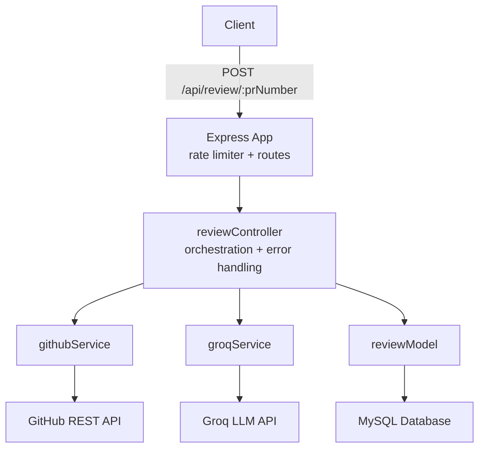

# ReviewPilot AI

An AI-powered code review backend that automatically analyzes GitHub pull requests and posts structured feedback as PR comments — built with Node.js, Express, Groq's LLM API, and MySQL.

## What it does

Given a GitHub PR number, ReviewPilot AI:

1. Fetches the changed files/diffs from the GitHub REST API
2. Sends each file's diff to an LLM (via Groq's API) with a structured code-review prompt
3. Collects feedback covering potential bugs, best-practice violations, and improvement suggestions
4. Posts a single consolidated comment back to the PR on GitHub
5. Persists every session and review (including AI feedback and whether it was successfully posted) to a MySQL database

## Tech stack

- **Backend:** Node.js, Express
- **AI:** Groq API (`openai/gpt-oss-20b`)
- **Database:** MySQL (raw `mysql2` driver, no ORM)
- **Testing:** Jest + Supertest (88% statement coverage)
- **Other:** `express-rate-limit` for API rate limiting, `axios` for HTTP calls, `dotenv` for config

## Architecture



- `src/services/githubService.js` — GitHub REST API calls (fetch PR files, post comments)
- `src/services/groqService.js` — Groq LLM API calls (code review generation)
- `src/models/reviewModel.js` — MySQL queries (sessions, reviews)
- `src/controllers/reviewController.js` — orchestrates the full pipeline, handles errors (404/400/422/502/207)
- `src/middleware/rateLimiter.js` — per-IP rate limiting

## Setup

1. Clone the repo, `cd backend`, run `npm install`
2. Create a `.env` file with:
   - `GITHUB_TOKEN`, `GITHUB_OWNER`, `GITHUB_REPO`
   - `GROQ_API_KEY`, `GROQ_MODEL`
   - `DB_HOST`, `DB_USER`, `DB_PASSWORD`, `DB_NAME`, `DB_PORT`
   - `RATE_LIMIT_WINDOW_MS`, `RATE_LIMIT_MAX_REQUESTS`
3. Create the MySQL database and tables (see schema below)
4. Run `npm run dev` (or `node server.js`)

## Database schema

```sql
CREATE DATABASE ai_code_reviewer;
USE ai_code_reviewer;

CREATE TABLE sessions (
    id INT AUTO_INCREMENT PRIMARY KEY,
    repo_owner VARCHAR(255) NOT NULL,
    repo_name VARCHAR(255) NOT NULL,
    created_at TIMESTAMP DEFAULT CURRENT_TIMESTAMP
);

CREATE TABLE reviews (
    id INT AUTO_INCREMENT PRIMARY KEY,
    session_id INT NOT NULL,
    pr_number INT NOT NULL,
    file_name VARCHAR(500),
    code_patch LONGTEXT,
    ai_feedback LONGTEXT,
    posted_to_github BOOLEAN DEFAULT FALSE,
    created_at TIMESTAMP DEFAULT CURRENT_TIMESTAMP,
    FOREIGN KEY (session_id) REFERENCES sessions(id) ON DELETE CASCADE
);
```

- **`sessions`** — one row per review run, recording which repo was reviewed and when
- **`reviews`** — one row per file reviewed within a session, storing the original diff, the AI-generated feedback, and whether it was successfully posted back to GitHub

## API

**POST** `/api/review/:prNumber`

Triggers a full review of the given PR number: fetches files, generates AI feedback per file, posts a combined comment to GitHub, and saves everything to MySQL.

## Testing

```
npx jest --coverage
```

14 tests covering the happy path and failure modes (invalid PR number, PR not found, Groq API failure, GitHub comment failure). External dependencies (`axios`, `mysql2/promise`) are mocked to keep tests fast and isolated from real network/DB calls.

## Notes

- `npm audit` currently reports 22 vulnerabilities, all confined to devDependencies (`nodemon`, `jest`) with no production runtime exposure. Fixing requires a breaking downgrade to much older major versions; deferred as not worth the risk.
